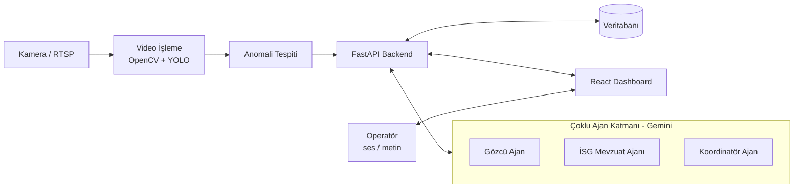

# LLM Destekli Çoklu Ajan Mimarisine Sahip, Sesle Yönetilebilir Akıllı Endüstriyel Güvenlik ve Anomali Analiz Sistemi

> **Trakya Üniversitesi – Proje Dersi**

Endüstriyel tesislerde ve kritik alanlarda güvenlik kameralarından alınan canlı görüntü akışlarını yapay zekâ ile analiz eden, güvenlik ihlallerini otonom olarak tespit eden ve **çoklu ajan (Multi-Agent) LLM asistanı** ile **sesli komutlarla** yönetilebilen web tabanlı bir güvenlik sistemidir.

---

## Proje Özeti

- Kamera görüntüleri **YOLO** tabanlı modellerle eşzamanlı analiz edilir (yasaklı bölge ihlali, baret/yelek eksikliği vb.).
- Tespit edilen anomaliler veritabanına kaydedilir ve alarm olarak panele iletilir.
- **Gemini API** tabanlı çoklu ajan yapısı anomali verilerini yorumlar, veritabanını sorgular ve operatöre özet sunar.
- Operatör, **Speech-to-Text / Text-to-Speech** sayesinde sistemi eller serbest (hands-free) yönetebilir.
- Web tabanlı **Dashboard** üzerinden canlı kamera gridleri, alarmlar ve sesli asistan tek merkezden yönetilir.

## Çözülen Sorunlar

| Sorun | Çözüm |
|---|---|
| Operatörün onlarca kamerayı uzun süre izlemesi (alarm yorgunluğu) | Otonom anomali tespiti ile yanlış alarm oranının düşürülmesi |
| Ham verinin manuel incelenmesi | LLM asistanının olayları özetlemesi |
| Kriz anında klavye/fare ile menülerde gezinme | Sesli komut ve sesli yanıt ile eller serbest yönetim |

## Öne Çıkan Özellikler

- **Çoklu Ajan Mimarisi:** Gözcü Ajan, İSG Mevzuat Ajanı ve Koordinatör Ajan birlikte çalışır.
- **Voice Copilot:** Operatör ile sistem arasında çift yönlü sesli iletişim (STT + TTS).
- **Gerçek Zamanlı Analiz:** YOLO ile video akışlarında anlık nesne/anomali tespiti.
- **Rol Tabanlı Erişim:** JWT kimlik doğrulama ve RBAC ile Operatör / Admin ayrımı.
- **Modüler ve Ölçeklenebilir Yapı:** Özelleştirilebilir loglama ve anomali sınıflandırma altyapısı.

---

## Teknoloji Yığını

**Backend**
- Python
- FastAPI
- Ultralytics YOLOv8 / YOLOv11
- OpenCV
- SQLAlchemy
- SQLite (geliştirme) / PostgreSQL (üretim)

**Frontend**
- React.js (Vite)
- TypeScript / JavaScript
- Tailwind CSS
- Web Speech API (STT / TTS)

**Yapay Zekâ / Servisler**
- Google Gemini API (Google AI Studio)
- Roboflow (veri seti etiketleme)
- Google Colab (model eğitimi)

**Araçlar:** VS Code, PyCharm, Git & GitHub, Trello, Discord / WhatsApp

---

## Sistem Mimarisi

## Kullanıcı Rolleri

| Rol | Yetkiler | Sınırlar |
|---|---|---|
| **Güvenlik Operatörü** | Canlı kamera izleme, sesli komut, alarmı onaylama / yanlış alarm işaretleme | Sistem ayarlarını değiştiremez |
| **Sistem Yöneticisi (Admin)** | Kullanıcı yönetimi, log inceleme, kamera (RTSP) ekleme/kaldırma | Tam yetki |

---

## Proje Durumu

- [ ] Veri toplama ve model eğitimi
- [ ] Backend ve veritabanı
- [ ] Görüntü işleme ve video akışı
- [ ] Çoklu ajan ve ses entegrasyonu
- [ ] Ön yüz (Dashboard)
- [ ] Entegrasyon, test ve raporlama

---

## Kurulum ve Çalıştırma

> [!NOTE]
> Proje geliştirme aşamasındadır. Çalıştırma adımları, kod geliştirildikçe eklenecektir.

### Gereksinimler
- Python 3.10+
- Node.js 18+
- Git
- Google AI Studio'dan alınmış bir **Gemini API anahtarı**

### Tarayıcı Notu
Sesli komut özelliği Web Speech API kullanır. En iyi uyum için **Google Chrome** veya **Microsoft Edge** önerilir. Ses desteği olmayan tarayıcılarda metin tabanlı komut girişi kullanılabilir.

---

## Riskler ve B Planları

| Risk | B Planı |
|---|---|
| Işık / açı koşullarında düşük model doğruluğu | Hazır pretrained ağırlıklar, Roboflow ile veri seti çeşitliliğinin artırılması |
| Video işleme + LLM sorgularında gecikme | Frame skipping, asenkron kuyruklar |
| Tarayıcıda ses tanıma kısıtlaması | Metin tabanlı komut girişi (fallback) |

---

## Kaynaklar

- [Ultralytics YOLO Dokümantasyonu](https://docs.ultralytics.com/)
- [FastAPI Dokümantasyonu](https://fastapi.tiangolo.com/tutorial/)
- [Google AI Studio & Gemini API](https://ai.google.dev/docs)
- [React Dokümantasyonu](https://react.dev/learn)
- [Roboflow Blog](https://blog.roboflow.com/)
- Papers with Code (video anomali tespiti makaleleri)

---

## Yapay Zekâ Araç Kullanımı

Geliştirme sürecinde verimlilik amacıyla yapay zekâ araçlarından yararlanılmaktadır:
- **Kod geliştirme:** GitHub Copilot / Gemini Code Assist (FastAPI iskeletleri, React bileşenleri)
- **Dokümantasyon:** Rapor yazımında dilbilgisi denetimi ve akademik dil iyileştirmesi
- **Prompt mühendisliği:** Çoklu ajan sistem promptlarının optimize edilmesi